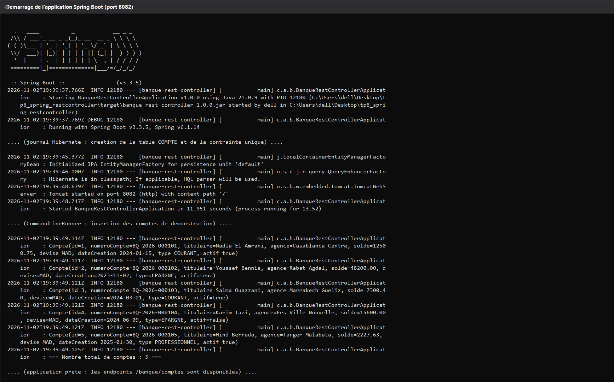
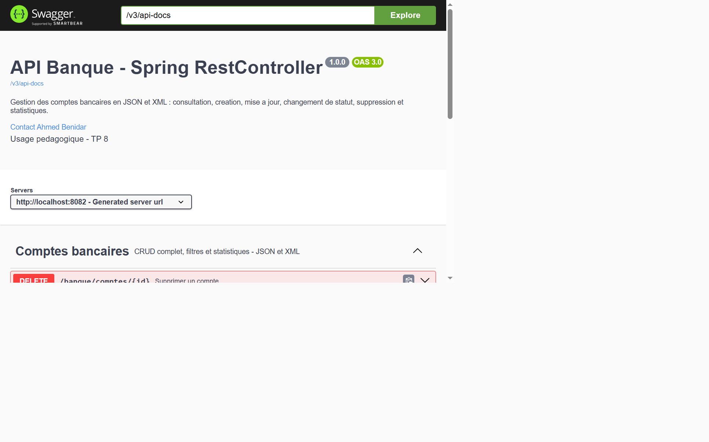
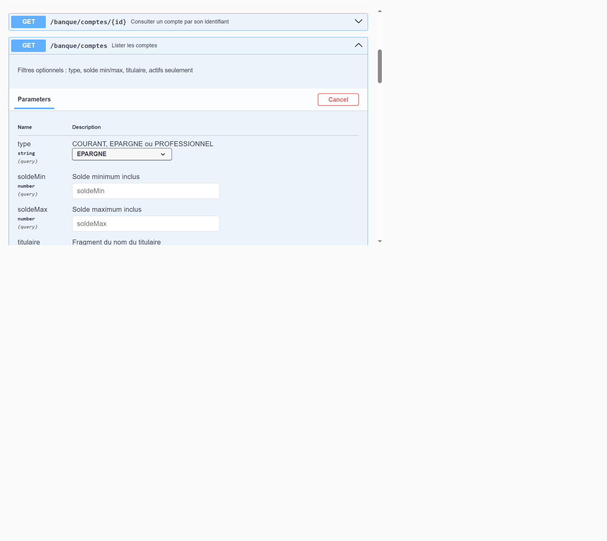
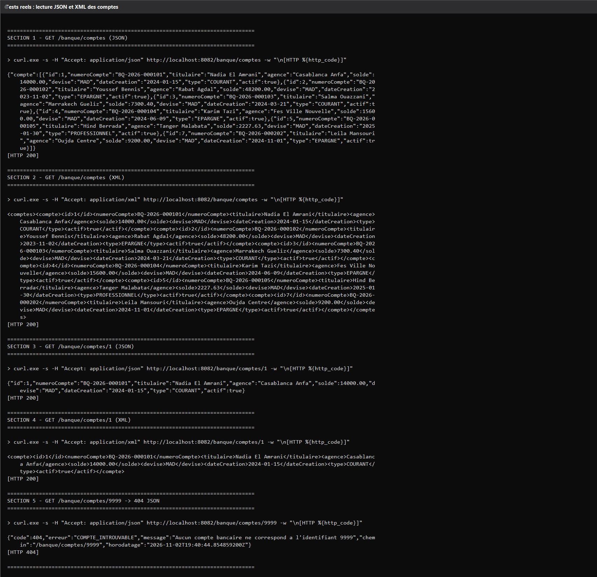
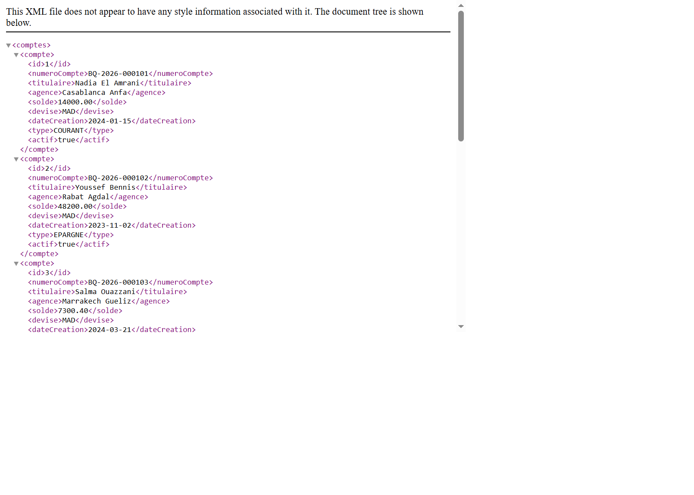
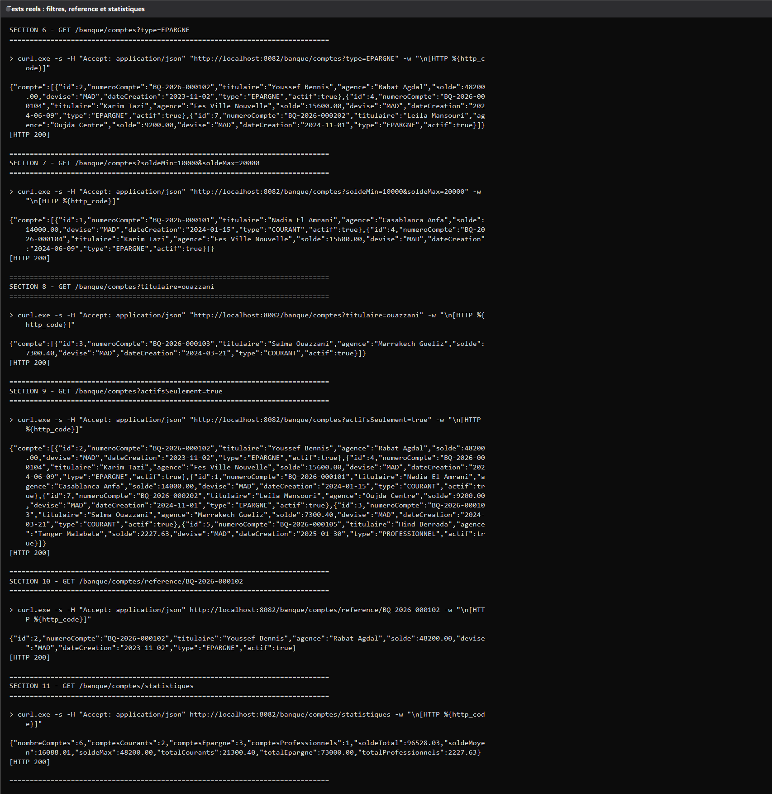
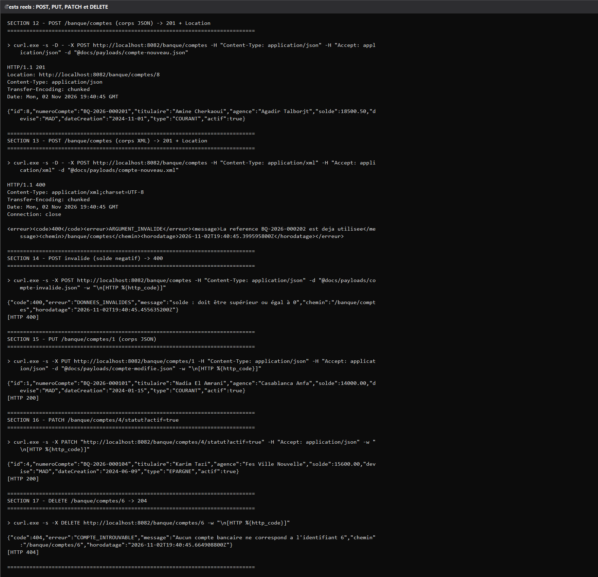
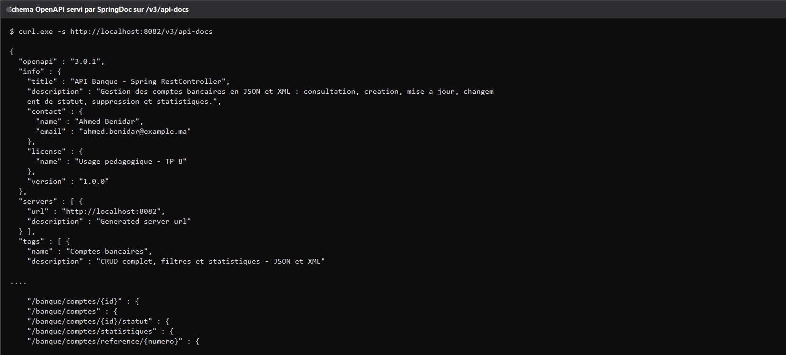
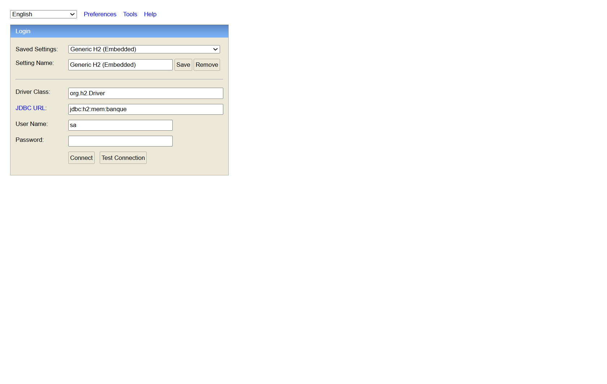
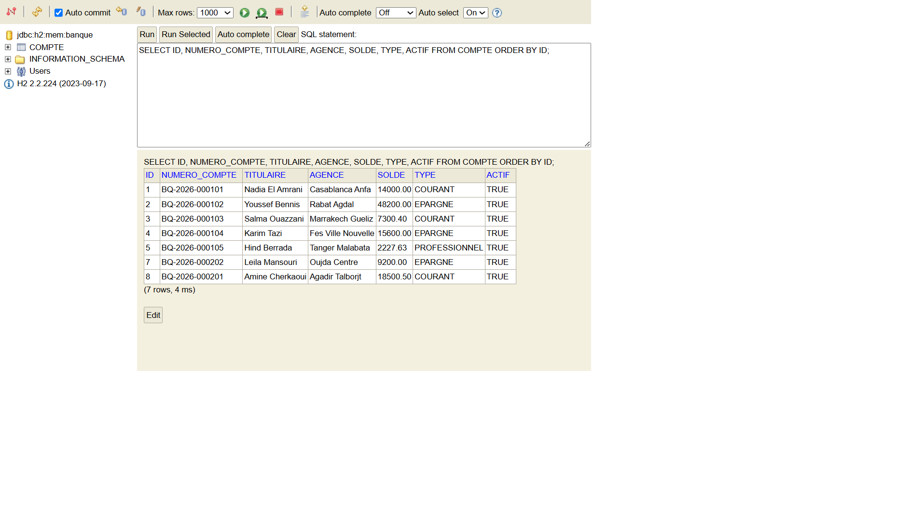

# TP 8 - API REST avec Spring RestController

Huitième TP du module Architecture Microservices : exposer les comptes d'une banque
en JSON **et** en XML depuis un seul contrôleur Spring, avec validation, gestion
centralisée des erreurs, filtres de recherche et documentation OpenAPI générée
automatiquement.

---

## Le projet en deux mots

Une application Spring Boot autonome, sans base externe : les données vivent dans une
base H2 en mémoire, alimentée au démarrage par cinq comptes de démonstration. Le
contrôleur expose huit points d'entrée sur le préfixe /banque/comptes et répond en
application/json comme en application/xml selon l'en-tête Accept de l'appelant.
L'application écoute sur le port **8082**.

Pour rester distinct des autres rendus, le domaine a été personnalisé : troisième type
de compte PROFESSIONNEL, références BQ-2026-XXXXXX, colis de données XML
spécifiques, filtres combinables et un endpoint de statistiques agrégées.

---

## 1. Démarrage de l'application

Le journal réel du lancement : Spring Boot 3.3.5 sur Java 21, Tomcat sur le port 8082,
création de la table COMPTE par Hibernate, puis le CommandLineRunner qui insère les
cinq comptes et affiche le total.

---

## 2. Le contrôleur dans Swagger

La documentation est générée par SpringDoc : les huit opérations, leurs paramètres et
leurs codes de retour sont décrits à partir des annotations du contrôleur.

Un essai réel depuis l'interface, filtré sur les comptes d'épargne, renvoie bien un code
200 avec le corps XML attendu.

---

## 3. Lecture des comptes en JSON et en XML

La même URL /banque/comptes renvoie du JSON ou du XML selon l'en-tête Accept. La
liste est enveloppée dans un élément racine comptes, chaque compte devenant un élément
compte. La lecture d'un compte unique suit la même logique, et un identifiant inconnu
déclenche une réponse 404 avec un corps d'erreur explicite.

Dans un navigateur, l'appel sans en-tête Accept particulier affiche l'arbre XML.

---

## 4. Filtres, recherche et statistiques

La liste accepte quatre filtres optionnels : le type de compte, un intervalle de solde,
un fragment du nom du titulaire et un drapeau pour ne garder que les comptes actifs. Un
endpoint dédié renvoie les indicateurs agrégés : nombre de comptes par catégorie, solde
total, solde moyen et solde maximum.

---

## 5. Écriture : création, remplacement, statut, suppression

La création accepte un corps JSON ou XML et répond un code 201 accompagné de l'en-tête
Location pointant vers la ressource créée. Le remplacement complet utilise PUT, le
changement de statut un PATCH, et la suppression répond un 204 sans corps. Un corps
invalide, ici un solde négatif, est intercepté par la validation et renvoyé en 400 avec
le message du champ fautif.

---

## 6. Contrat OpenAPI exposé

Le schéma complet est servi sur /v3/api-docs : il reprend le titre, la description, les
informations de contact et les cinq chemins de l'API.

---

## 7. Vérification côté base

La console H2 est activée sur /h2-console. Connectée à la même base mémoire que
l'application, elle permet de constater l'effet réel des appels précédents : les comptes
créés sont présents, celui supprimé a bien disparu et le compte réactivé porte la valeur
attendue.

---

## Ce qui a été mis en place

Le contrôleur porte l'annotation @RestController, ce qui suffit à sérialiser
automatiquement les objets renvoyés : aucun passage manuel par un convertisseur, aucun
appel à une vue. Le double format JSON et XML repose sur l'en-tête produces déclaré au
niveau de la classe et sur l'ajout du module XML à Jackson.

Les entités sont validées avant d'atteindre la couche métier grâce à @Valid et aux
contraintes portées par les champs. Toutes les erreurs remontent ensuite par un seul
gestionnaire global qui produit un corps homogène, avec code, libellé, message, chemin
appelé et horodatage.

Les traitements métier sont isolés dans un service transactionnel : génération
automatique de la référence quand elle est absente, refus des doublons, valeurs par
défaut pour la date, la devise et l'agence, arrondi monétaire à deux décimales.

Les captures de ce document proviennent toutes de l'application réellement lancée : les
journaux du terminal, les réponses de l'interface Swagger et l'état de la base ont été
relevés sur l'exécution locale, sans donnée simulée.

---

## Lancer le projet

L'application se démarre depuis le dossier du projet avec Maven, ou directement avec le
jar produit. Le port 8082 doit être libre. Une fois démarrée, la documentation interactive
est accessible sur /swagger-ui.html et la console de base sur /h2-console, avec la
même URL JDBC que celle déclarée dans la configuration, l'utilisateur sa et un mot de
passe vide.

---

*Travail réalisé dans le cadre du TP 8 du module Architecture Microservices.*